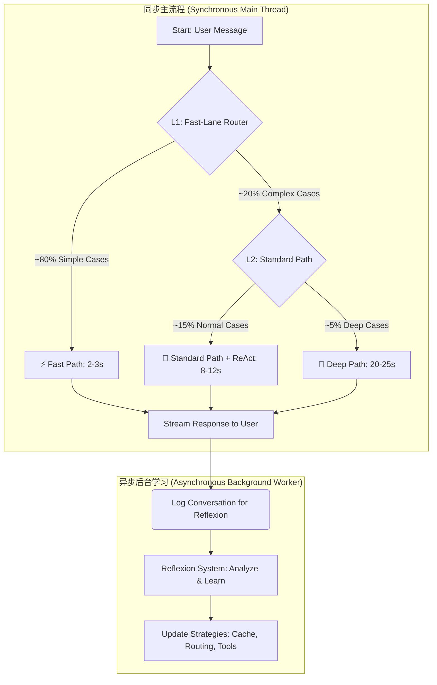

# Daisy Agent性能与架构优化技术规格书 (v1.0)

## 1. 文档目的

本技术规格书（Tech Spec）旨在为开发团队提供一份清晰、可执行的实施指南，以解决当前Daisy Agent响应延迟过高（长达1分钟）的性能问题，并对其架构进行现代化升级。

**目标读者**：后端开发工程师、AI工程师、架构师。

**核心目标**：将80%以上对话的**用户感知延迟**降低至**3秒以内**，并为系统引入持续学习和与外部世界交互的能力。

---

## 2. 目标架构概览

我们将从当前的**“固定流程DAG”**架构，演进为**“三层智能路由 + 异步反思学习”**的混合架构。该架构的核心是根据对话的实时上下文，动态选择最高效的处理路径。

### 2.1 目标架构图



---

## 3. Phase 1: 核心性能优化 (MVP)

**目标**：在2周内完成，将物理响应时间从60秒降至10-35秒，快速解决核心痛点。

### 3.1 需求 1.1：实现智能路由 (Intelligent Router)

*   **需求描述**：创建一个路由节点，作为工作流的入口，将对话动态分类为`FAST`、`STANDARD`、`DEEP`三个等级。
*   **技术方案**：
    1.  **实现`IntelligentRouter`类**：该类包含一个`route`方法，输入为`AgentState`，输出为路由决策字符串（`FAST`, `STANDARD`, `DEEP`）。
    2.  **路由逻辑**：采用“规则优先”策略，以降低LLM调用和延迟。
        *   **Step 1 (规则匹配)**：通过正则表达式和关键词列表，快速识别简单问候、确认等（如“晚安”、“好的”、“👍”）。匹配成功则立即返回`FAST`。
        *   **Step 2 (LLM判断)**：若规则未匹配，则调用一个**轻量级LLM**（如`gpt-4.1-mini`），根据用户输入、情感分析等上下文，判断其复杂度，返回`STANDARD`或`DEEP`。
    3.  **LangGraph集成**：将`route`方法作为`set_conditional_entry_point`的判断逻辑，将工作流引导至不同的处理分支。
*   **伪代码示例**：
    ```python
    # core/router.py
    class IntelligentRouter:
        def __init__(self):
            self.fast_patterns = [r'^(好|嗯|是|对|行|可以)[啊呀的吗]*[！!。.]*$', ...]

        async def route(self, state: dict) -> str:
            user_input = state['messages'][-1].content
            # 规则匹配...
            if is_fast_match:
                return "FAST"
            
            # LLM判断...
            # prompt = f"...判断复杂度..."
            # decision = await call_llm(prompt, model="gpt-4.1-mini")
            # return decision.strip()
            return "STANDARD" # 默认

    # graph.py
    def route_logic(state: AgentState):
        # ... 调用router.route...
        return asyncio.run(router.route(state))

    workflow.set_conditional_entry_point(route_logic, ...)
    ```
*   **验收标准 (AC)**：
    *   AC-1.1.1: 输入“好的”，路由决策为`FAST`。
    *   AC-1.1.2: 输入“你觉得爱是什么？”，路由决策为`DEEP`。
    *   AC-1.1.3: 路由节点的平均执行时间应小于500ms。

### 3.2 需求 1.2：重构内心独白为单次调用 (Personality Fusion Engine)

*   **需求描述**：将当前基于CrewAI的、需要3-6次LLM调用的`agent_thoughts`节点，重构为**一次LLM调用**即可完成的“人格融合引擎”。
*   **技术方案**：
    1.  **创建结构化Prompt模板**：设计一个YAML格式的Prompt模板，该模板要求LLM以**JSON格式**输出，包含`internal_monologues`（各人格独白）、`fusion_strategy`（融合策略）和`final_internal_state`（最终内心状态）三个字段。
    2.  **实现`PersonalityFusionEngine`类**：该类负责加载Prompt、填充上下文、调用LLM，并解析返回的JSON。需包含对JSON解析失败的`try-except`降级处理逻辑。
    3.  **模型选择**：根据路由结果选择不同能力的模型。`DEEP`路径使用`gpt-4.1`，`STANDARD`路径使用`gpt-4.1-mini`。
*   **伪代码示例**：
    ```python
    # core/fusion.py
    class PersonalityFusionEngine:
        async def run(self, state: dict) -> dict:
            # ... 填充prompt模板 ...
            # model_config = get_model_for_route(state['route'])
            # response_text = await call_llm(prompt, **model_config, response_format={"type": "json_object"})
            try:
                state['agent_thoughts'] = json.loads(response_text)
            except json.JSONDecodeError:
                state['agent_thoughts'] = {"error": "..."}
            return state
    ```
*   **验收标准 (AC)**：
    *   AC-1.2.1: `agent_thoughts`节点在执行期间，仅发起一次对LLM的调用。
    *   AC-1.2.2: 该节点的输出必须是符合预定义结构的有效JSON对象。
    *   AC-1.2.3: 该节点的执行耗时相比旧方案，应减少至少60%。

### 3.3 需求 1.3：实现智能缓存 (Smart Caching L1/L2)

*   **需求描述**：为高频、可复用的计算节点（如沟通风格分析）增加缓存，减少不必要的LLM调用。
*   **技术方案**：
    1.  **实现`MultiLevelCache`类**：提供`get`和`set`方法，支持L1（in-memory `dict`）和L2（Redis）两级缓存。
    2.  **缓存目标**：
        *   **沟通风格分析结果**：以`user_id`为key，缓存30分钟。
        *   **用户画像**：以`user_id`为key，缓存1小时。
        *   **路由决策**：以`user_input`的哈希为key，缓存10分钟。
    3.  **实现方式**：建议使用**装饰器模式**，为需要缓存的节点函数添加`@cache_node`装饰器，自动处理缓存的读写逻辑。
*   **伪代码示例**：
    ```python
    # intelligence/cache.py
    def cache_node(key_prefix: str, ttl: int):
        def decorator(func):
            async def wrapper(state: dict):
                # cache_key = f"{key_prefix}:{state['user_id']}"
                # cached = await cache.get(cache_key)
                # if cached: return cached
                # result = await func(state)
                # await cache.set(cache_key, result, ttl=ttl)
                # return result
            return wrapper
        return decorator

    # graph.py
    # @cache_node("style_analysis", ttl=1800)
    # async def analyze_style_node(state: dict): ...
    ```
*   **验收标准 (AC)**：
    *   AC-1.3.1: 在30分钟内对同一用户连续发起对话，第二次及以后的`analyze_style_node`应从缓存中读取，日志中应有`CACHE HIT`记录，且不产生LLM调用。
    *   AC-1.3.2: Redis中应能查到对应`user_id`的缓存键值对。

---

## 4. Phase 2: 体验升级与功能扩展

**目标**：在2-3周内完成，将用户感知延迟降至5秒以内，并赋予Agent与外部世界交互的能力。

### 4.1 需求 2.1：实现流式输出 (Streaming Output)

*   **需求描述**：改造最终的回复生成节点，使其能够以流的形式将内容逐步返回给前端。
*   **技术方案**：
    1.  在调用最终生成回复的LLM时，启用`stream=True`选项。
    2.  LangGraph的`app.stream()`或`app.astream()`方法会返回一个异步生成器，前端需要消费这个生成器，将收到的`content chunk`实时拼接并显示在UI上。
*   **验收标准 (AC)**：
    *   AC-2.1.1: 用户发送消息后，UI上应在3秒内开始显示回复的第一个字符。

### 4.2 需求 2.2：集成轻量级ReAct模式 (Tool Calling)

*   **需求描述**：在`STANDARD`和`DEEP`路径中，增加一个工具调用检查节点，使Agent能在必要时（如查询天气、电影评分）使用外部工具。
*   **技术方案**：
    1.  **创建`tool_check`节点**：该节点调用轻量级LLM，判断当前对话是否需要使用工具。
    2.  **创建`react_loop`节点**：如果需要工具，则进入该节点，执行一个最多2轮的“思考->行动->观察”循环。
    3.  **工具定义**：在`core/tools.py`中定义可用的工具，如`search`、`calculator`。
*   **验收标准 (AC)**：
    *   AC-2.2.1: 输入“今天北京天气怎么样？”，Agent应能触发`search`工具，并返回包含实时天气信息的回复。

---

## 5. Phase 3: 智能化自主演进 (长期)

### 5.1 需求 3.1：实现异步反思系统 (Async Reflexion)

*   **需求描述**：创建一个完全在后台运行的、不阻塞主流程的学习系统。
*   **技术方案**：
    1.  **实现`AsyncReflexionSystem`类**：内部维护一个`asyncio.Queue`。
    2.  **主流程集成**：在每次对话结束时，将对话的关键信息（输入、输出、情感、路由等）作为一个事件`put`到队列中。
    3.  **后台Worker**：启动一个常驻的异步任务`reflection_worker`，不断从队列中`get`事件，调用LLM进行反思，并将学习到的“经验教un”存入长期记忆或用于更新缓存策略。
*   **验收标准 (AC)**：
    *   AC-3.1.1: 即使用户快速连续对话，主流程的响应时间也不应受到反思过程的影响。
    *   AC-3.1.2: 在数据库或日志中，应能查到由反思系统生成的“改进建议”记录。

---

## 6. 总结

本规格书提供了一套从解决眼前性能问题到实现长期智能化演进的完整开发蓝图。建议开发团队严格按照Phase 1 -> Phase 2 -> Phase 3的顺序进行实施，优先交付核心性能优化，以最快速度改善用户体验。
