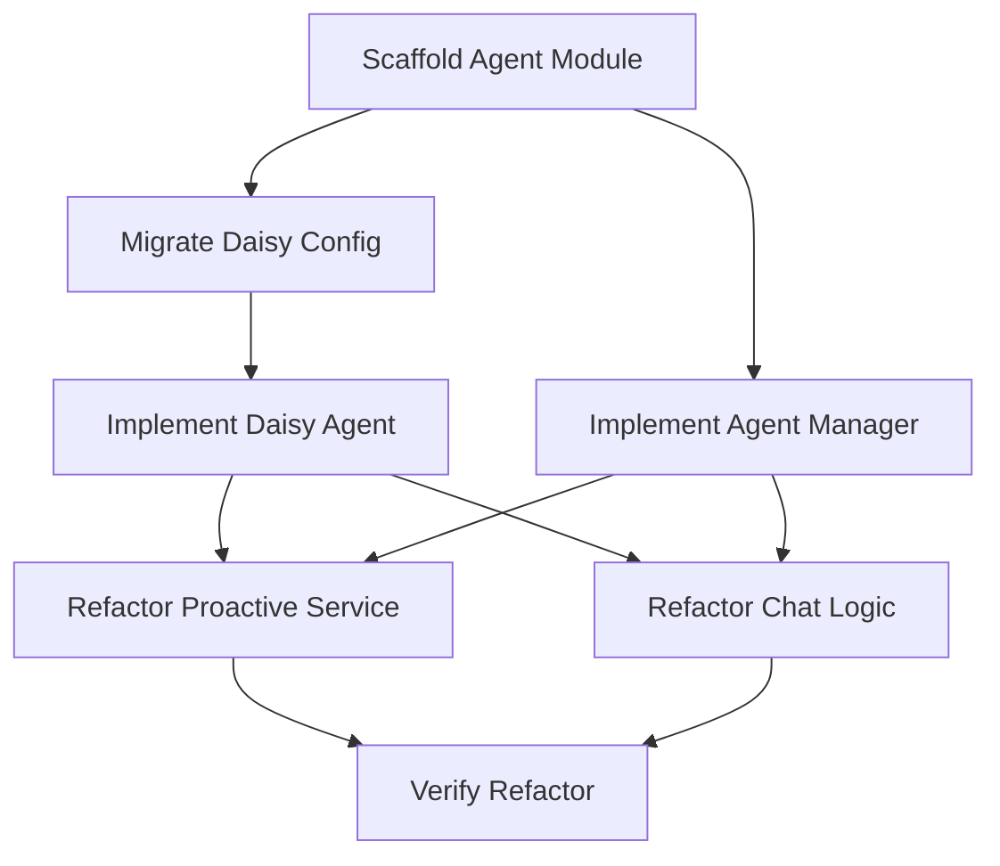

# TASK: Multi-Agent Refactoring

## Task Graph

## Atomic Tasks

### Task 1: Scaffold Agent Module
- **File**: `app/agents/__init__.py`, `app/agents/base.py`, `app/agents/manager.py`
- **Goal**: Create the `BaseAgent` abstract class and `AgentManager` singleton.
- **Input**: `DESIGN_Refactor_Multi_Agent.md`
- **Output**: Python files with class definitions.

### Task 2: Migrate Daisy Config
- **File**: `app/agents/daisy/config.py`, `app/agents/daisy/__init__.py`
- **Goal**: Move `CommonSettings`, `RoleProfile`, and `INITIAL_PROFILES` from `app/prompts/templates.py` to `app/agents/daisy/config.py`.
- **Input**: `app/prompts/templates.py`
- **Output**: New config file.

### Task 3: Implement Daisy Agent
- **File**: `app/agents/daisy/agent.py`
- **Goal**: Implement `DaisyAgent` class inheriting from `BaseAgent`.
    - Implement `get_system_prompt`.
    - Implement `check_proactive_trigger` (extract logic from `ProactiveService`).
- **Input**: `app/services/proactive_service.py` logic.
- **Output**: `DaisyAgent` class.

### Task 4: Refactor Proactive Service
- **File**: `app/services/proactive_service.py`
- **Goal**: Replace hardcoded logic with `AgentManager.get_agent().check_proactive_trigger()`.
- **Input**: `DaisyAgent` implementation.
- **Output**: Cleaned up service.

### Task 5: Refactor Chat/Prompt Logic (Partial)
- **File**: `app/prompts/templates.py` (Deprecate/Modify)
- **Goal**: Ensure that `get_core_system_instructions` calls the Agent instead of using hardcoded logic, OR make `DaisyAgent` the source of truth.
- **Note**: For this refactor, we might leave `templates.py` as a wrapper that calls `DaisyAgent` to minimize breaking changes in `app/core`.

### Task 6: Verify Refactor
- **File**: `tests/`
- **Goal**: Run existing tests and verify system still starts and chat works.
- **Action**: `python -m pytest` or manual script run.
