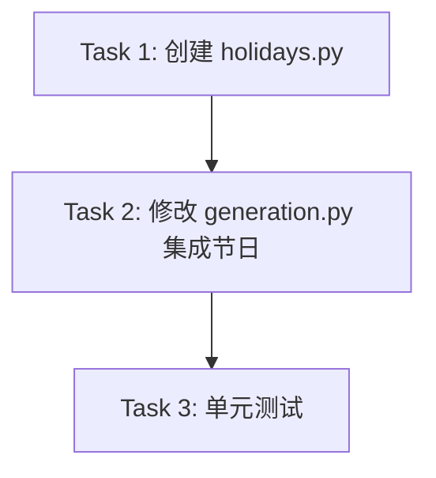

# TASK: 节假日感知实施计划

## 任务依赖图

## 原子任务清单

### Task 1: 创建 `app/core/holidays.py`
- **内容**: 实现 `HolidayManager` 类及其静态数据。
- **验收**: 能正确识别 2024-12-25 和 2025-01-29。

### Task 2: 修改 `app/workflow/nodes/generation.py`
- **内容**: 
    - 导入 `HolidayManager`。
    - 在 `_generate_costar_instruction` 中获取节日。
    - 动态构建 Prompt (仅当有节日时插入相关 Constraint)。
- **验收**: 生成的 Prompt 包含节日信息。

### Task 3: 单元测试
- **内容**: 创建 `tests/test_holidays.py`，覆盖公历、农历、无节日三种情况。
- **验收**: 测试全部通过。
