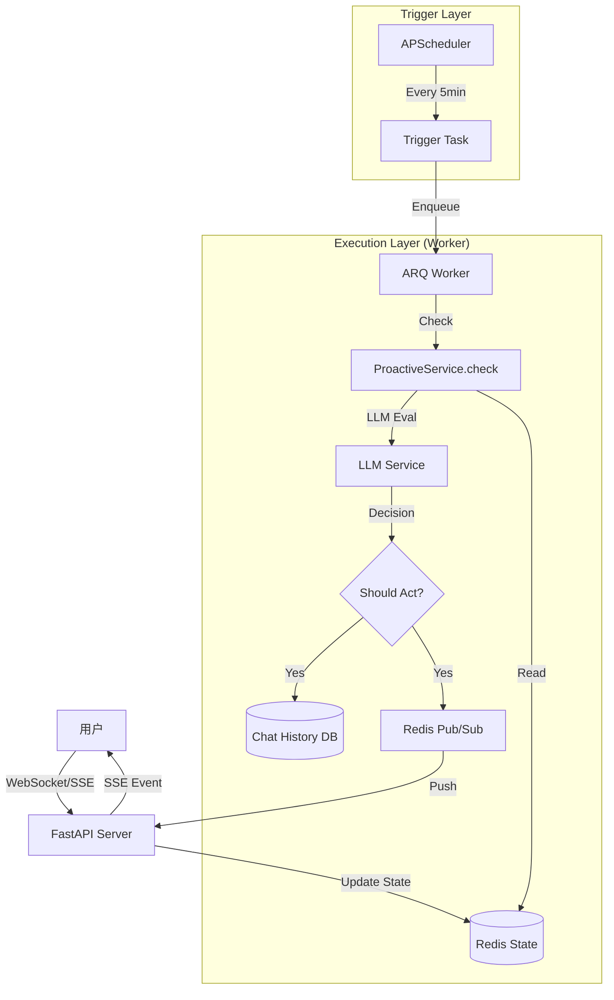

# DESIGN: 主动对话机制设计方案

## 1. 核心架构

系统采用 **"Event-Driven Scheduler + Worker"** 架构，将触发逻辑与执行逻辑分离。



## 2. 模块设计

### 2.1 状态服务 (StateService)
负责维护用户的实时状态和长期画像。

*   **在线状态**: `user:{id}:online` (Set/Bitmap)
*   **最后活跃**: `user:{id}:last_active_at` (Timestamp)
*   **作息统计**: `user:{id}:activity_stats` (Hash: Hour -> Count)
    *   每次用户发消息，`HINCRBY` 对应小时的计数。
    *   计算概率: $P = \frac{Count(CurrentHour)}{Max(Counts)}$
*   **情感状态**: `user:{id}:last_emotion` (Hash: label, score, timestamp)

### 2.2 主动服务 (ProactiveService)
核心业务逻辑，包含双轨判定。

#### 双轨门控 (Dual-Track Gatekeeper)
1.  **输入**: 用户ID、当前时间、情感状态。
2.  **流程**:
    *   **Track A (Emotional)**:
        *   Check: `Emotion.score > 0.6` AND `Emotion in [sadness, lonely]` AND `Time < 12h ago`.
        *   Result: `Override = True` (豁免作息检查，放宽冷却)。
    *   **Track B (Routine)**:
        *   Check: `ActivityProb > 0.05` (非深度睡眠时间)。
        *   Check: `LastActive > 5min` (非正在聊天)。
        *   Check: `DailyCount < Max`.
        *   Check: `Cooldown > 4h`.
3.  **输出**: `ShouldProceed` (Boolean).

#### LLM 决策与生成
*   **Prompt**: 包含时间、用户情感、最近 5 条对话。
*   **Task**: "Decide if you should initiate conversation."
*   **Output**: JSON `{score: 8, content: "..."}`.

### 2.3 消息推送
*   使用 Redis Pub/Sub 机制。
*   Channel: `chat:stream:{user_id}`.
*   Event Type: `proactive_message`.

## 3. 数据模型

### ChatHistoryDB
复用现有模型，新增/规范字段：
*   `role`: "ai" (与被动回复一致).
*   `type`: (虽然代码中移除了，但逻辑上属于 Text).
*   `session_id`: 独立生成的 ID，或复用最近的 Session。

## 4. 接口设计

### SSE 协议扩展
前端需要处理新的事件类型：
```json
{
  "type": "proactive_message",
  "content": "晚安，今天过得怎么样？",
  "timestamp": "2026-01-02T22:00:00"
}
```

## 5. 安全与性能
*   **并发控制**: ARQ 队列确保不会同时对同一用户发起多个检查。
*   **资源隔离**: 主动任务在独立 Worker 容器运行，不影响 API 响应速度。
*   **LLM 熔断**: 如果 LLM 响应超时或错误，静默失败，不打扰用户。
