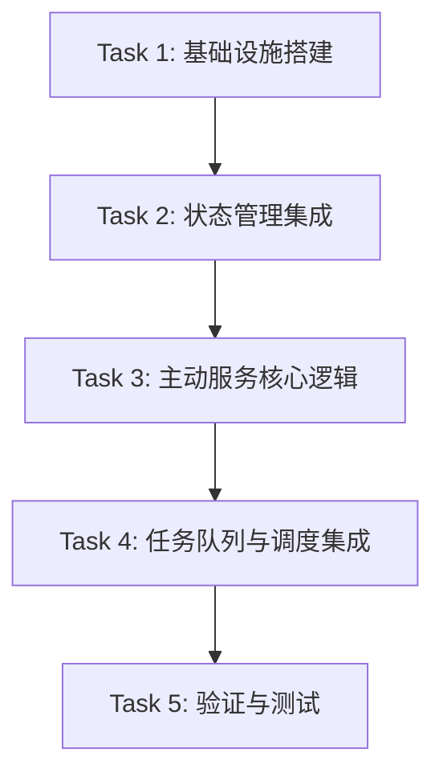

# TASK: 陪伴式AI主动对话机制实施计划

## 1. 任务依赖图

## 2. 原子任务清单

### Task 1: 基础设施搭建 (Infrastructure)
- [x] **目标**: 在 FastAPI 应用中集成 `APScheduler` 并配置生命周期管理。
- [x] **文件**: `app/core/scheduler.py`, `app/main.py`
- [x] **步骤**:
    1.  创建 `SchedulerManager` 类，封装 `BackgroundScheduler`。
    2.  在 `app/main.py` 的 `lifespan` 中添加 scheduler 的 start 和 shutdown。
    3.  验证 scheduler 能在后台运行简单的 print 任务。
- [x] **验收**: 启动服务器日志中看到 Scheduler started，并没有阻塞主进程。

### Task 2: 状态管理与作息学习集成 (State & Learning)
- [x] **目标**: 利用 Redis 维护用户状态，并实现作息规律学习。
- [x] **文件**: `app/services/state_service.py` (新增), `app/api/server.py`
- [x] **步骤**:
    1.  实现 `StateService`:
        - `mark_user_online(user_id)` / `mark_user_active(user_id)`
        - `update_activity_stats(user_id)`: 增加当前小时的活跃计数。
        - `get_activity_probability(user_id, hour)`: 计算活跃概率。
    2.  集成到 API:
        - `/chat/stream` 建立连接时标记 online。
        - `/chat` 收到消息时调用 `update_activity_stats` 和 `mark_user_active`。
- [x] **验收**: 发送几条消息后，Redis `user:{id}:activity_stats` 对应小时的计数增加。

### Task 3: 主动服务核心逻辑 (Core Logic)
- [x] **目标**: 实现“检查-决策-生成”的核心业务逻辑，包含自适应防打扰。
- [x] **文件**: `app/services/proactive_service.py` (新增)
- [x] **步骤**:
    1.  实现自适应门控 `check_adaptive_gatekeeper(user_id)`:
        - 调用 `StateService.get_activity_probability`。
        - 如果概率低且样本足 -> 拦截。
        - 每日上限 & 动态冷却检查。
    2.  实现 `evaluate_necessity(user_id, context)`:
        - 构造 Prompt 让 LLM 打分。
    3.  实现 `generate_and_send(user_id)`:
        - Rule Check & Score >= 8 -> 执行。
- [x] **验收**: 单元测试验证在“低概率活跃时段”会被 Gatekeeper 拦截。

### Task 4: 任务队列与调度集成 (Integration)
- [x] **目标**: 将调度器、Worker 和服务逻辑串联。
- [x] **文件**: `app/tasks/proactive_task.py` (新增), `app/tasks/worker.py`, `app/core/scheduler.py`
- [x] **步骤**:
    1.  在 `app/tasks` 中定义 `trigger_proactive_check_task(user_id)`，调用 `ProactiveService`。
    2.  在 `worker.py` 中注册该任务。
    3.  在 `SchedulerManager` 中添加定时作业（例如每 5 分钟），遍历在线用户并分发任务。
- [x] **验收**: 模拟触发调度，Worker 日志显示任务执行，并最终在 Redis 频道收到消息。

### Task 5: 验证与测试 (Verification)
- [x] **目标**: 端到端验证功能。
- [x] **文件**: `scripts/verify_proactive.py`
- [x] **步骤**:
    1.  编写脚本模拟用户在线（订阅 Redis）。
    2.  手动触发调度任务。
    3.  验证是否收到主动消息。
    4.  验证冷却机制（再次触发应无消息）。
- [x] **验收**: 脚本运行通过，所有断言成功。
