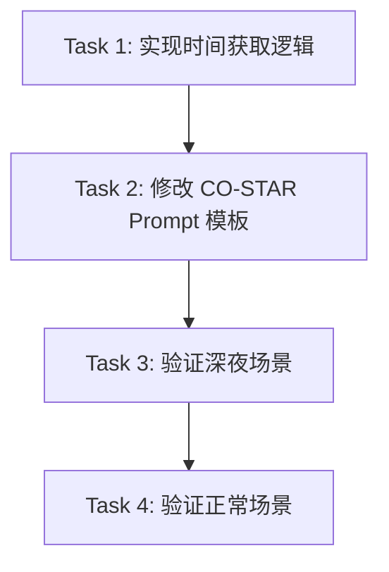

# TASK: 时间感知能力实施计划

## 任务依赖图

## 原子任务清单

### Task 1: 实现时间获取逻辑
- **文件**: `app/workflow/nodes/generation.py`
- **内容**: 
    - 导入 `datetime`。
    - 实现 `_get_time_context` 逻辑（或直接内联在 `_generate_costar_instruction` 中）。
- **验收**: 代码无语法错误，能正确打印当前时间。

### Task 2: 修改 CO-STAR Prompt 模板
- **文件**: `app/workflow/nodes/generation.py`
- **内容**:
    - 在 `_generate_costar_instruction` 中将时间信息注入到 `final_prompt` 字符串中。
    - 重点修改 `Constraint Layer` 部分。
- **验收**: 生成的 Prompt 包含 "当前时间" 和 "时间感知" 约束。

### Task 3: 验证深夜场景 (手动测试)
- **操作**: 
    - 临时修改代码强制时间为 02:00。
    - 运行对话，输入 "我想喝咖啡"。
- **验收**: AI 回复劝阻喝咖啡，建议休息。

### Task 4: 恢复并验证正常场景
- **操作**: 
    - 移除强制时间，使用系统时间。
    - 运行对话，确认功能正常。
- **验收**: 对话流畅，无报错。
