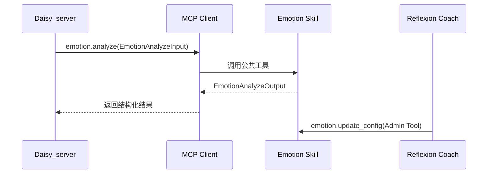
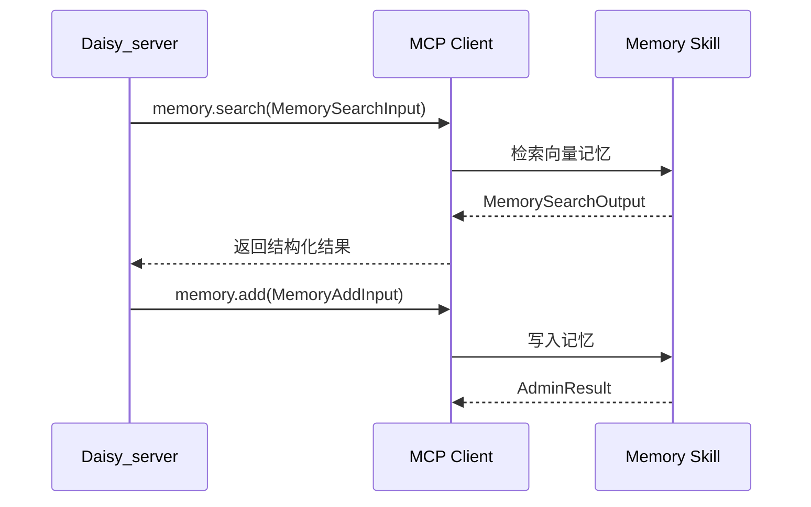
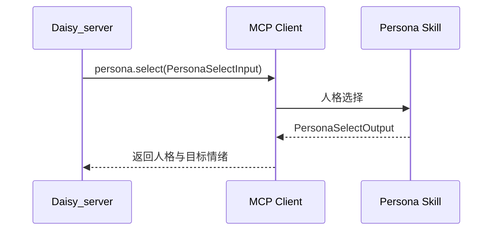

# Daisy Skills 服务技术文档

## 1. 文档目标

本技术文档定义 `Daisy_skills` 的完整实现方案，覆盖：
- 项目目录结构与模块边界
- MCP 服务分层与运行形态
- Skills 设计原则与接口契约
- Admin Tools 与异步学习闭环的协同方式

本文档面向落地实现，强调与 `Daisy_server` 既有能力对齐，并保持可扩展性。

## 2. 架构定位

`Daisy_skills` 是“能力层服务”，以 MCP Server 形态对外暴露 Skills。它与 `Daisy_server` 的分工如下：

- `Daisy_server`：编排层与业务入口，负责对话流程、路由与状态管理
- `Daisy_skills`：能力层与工具执行，负责具体能力实现与资源访问
- Reflexion Coach：独立后台学习与调参服务（不属于 `Daisy_skills`，但使用其 Admin Tools）

## 3. 项目目录结构

```
Daisy_skills/
  app/
    core/
      config.py
      logging.py
      mcp_runtime.py
      error.py
      registry.py
    skills/
      emotion/
        __init__.py
        service.py
        schema.py
        tool.py
        admin_tool.py
      memory/
        __init__.py
        service.py
        schema.py
        tool.py
        admin_tool.py
      persona/
        __init__.py
        service.py
        schema.py
        tool.py
        admin_tool.py
      topic/
        __init__.py
        service.py
        schema.py
        tool.py
      portrait/
        __init__.py
        service.py
        schema.py
        tool.py
      toolhub/
        __init__.py
        service.py
        schema.py
        tool.py
    shared/
      db.py
      redis.py
      llm.py
      models.py
      utils.py
    main.py
  tests/
  docs/
  pyproject.toml
```

目录说明：
- `core/`：MCP 运行时、注册表、错误模型、配置
- `skills/`：能力实现单元，每个 Skill 自带 schema、公共工具与管理工具
- `shared/`：与 `Daisy_server` 共享的 DB/Redis/LLM 访问与数据模型
- `main.py`：MCP Server 入口，注册所有工具

## 4. MCP 服务形态

`Daisy_skills` 以 MCP Server 运行，支持 Stdio 与 TCP 两种模式：

- **Stdio 模式**：用于本地或单容器部署
- **TCP 模式**：用于多服务部署或 Sidecar 运行

对 `Daisy_server` 的调用方式：
- MCP Client 在启动时加载工具列表
- LangGraph 节点通过 MCP Client 调用 Skills

## 5. Skills 设计原则

1. **单一职责**：每个 Skill 只做一类能力
2. **稳定契约**：输入/输出结构固定，不依赖上下游隐式状态
3. **无状态优先**：除非必要，不持久化状态
4. **错误可追踪**：所有错误以结构化结果返回
5. **可演化**：支持 Admin Tools 调参或更新策略

## 6. 核心模块设计

### 6.1 Core Runtime

**职责**
- 加载配置
- 启动 MCP Server
- 注册 Tools

**关键模块**
- `mcp_runtime.py`：启动 MCP 运行时
- `registry.py`：集中管理工具与能力
- `error.py`：统一错误结构

### 6.2 Shared 层

**职责**
- DB 访问与模型复用
- Redis 访问与缓存
- LLM 访问统一封装

该层保持与 `Daisy_server` 共享的数据结构一致，避免重复定义。

## 7. Skills 详细设计

### 7.1 Emotion Skill

**能力定位**：情绪分析与 Ekman 映射

**Public Tool**
- 名称：`emotion.analyze`
- 输入：`EmotionAnalyzeInput`
- 输出：`EmotionAnalyzeOutput`

**Admin Tool**
- 名称：`emotion.update_config`
- 输入：`EmotionConfigInput`
- 输出：`AdminResult`

**核心逻辑来源**
- 迁移自 `Daisy_server/services/emotion.py`

**数据结构**
- `EmotionAnalyzeInput`: `text`, `user_id`, `session_id`, `language_hint`
- `EmotionAnalyzeOutput`: `scores`, `ekman_scores`, `top_emotions`, `engagement_score`

**字段说明**

`EmotionAnalyzeInput`

| 字段 | 类型 | 必填 | 说明 |
| --- | --- | --- | --- |
| text | string | 是 | 待分析文本 |
| user_id | string | 是 | 用户标识 |
| session_id | string | 是 | 会话标识 |
| language_hint | string | 否 | 语言提示，如 zh/en |
| context_history | array | 否 | 最近对话片段，用于上下文辅助 |

`EmotionAnalyzeOutput`

| 字段 | 类型 | 必填 | 说明 |
| --- | --- | --- | --- |
| scores | object | 是 | 情绪维度分数映射 |
| ekman_scores | object | 是 | Ekman 六类分数映射 |
| top_emotions | array | 是 | Top 情绪列表，包含 name 与 score |
| engagement_score | number | 是 | 互动参与度评分 |

`EmotionConfigInput`

| 字段 | 类型 | 必填 | 说明 |
| --- | --- | --- | --- |
| model_name | string | 否 | 情绪模型名称 |
| context_turns | integer | 否 | 上下文轮数 |
| context_max_chars | integer | 否 | 上下文最大字符数 |
| ekman_mapping_version | string | 否 | 映射版本标识 |

### 7.2 Memory Skill

**能力定位**：向量记忆检索与写入

**Public Tools**
- `memory.search`
- `memory.add`

**Admin Tool**
- `memory.update_policy`

**核心逻辑来源**
- 迁移自 `Daisy_server/services/memory.py` 与 `workflow/nodes/memory.py`

**数据结构**
- `MemorySearchInput`: `query`, `user_id`, `limit`, `topic_summary`
- `MemorySearchOutput`: `memories`, `query_used`
- `MemoryAddInput`: `text`, `user_id`, `metadata`

**字段说明**

`MemorySearchInput`

| 字段 | 类型 | 必填 | 说明 |
| --- | --- | --- | --- |
| query | string | 是 | 检索查询内容 |
| user_id | string | 是 | 用户标识 |
| limit | integer | 否 | 返回条数上限 |
| topic_summary | string | 否 | 当前话题摘要 |
| session_id | string | 否 | 会话标识 |
| filters | object | 否 | 过滤条件，如时间范围或标签 |

`MemorySearchOutput`

| 字段 | 类型 | 必填 | 说明 |
| --- | --- | --- | --- |
| memories | array | 是 | 记忆列表，包含 text、score、metadata |
| query_used | string | 是 | 实际执行的查询文本 |

`MemoryAddInput`

| 字段 | 类型 | 必填 | 说明 |
| --- | --- | --- | --- |
| text | string | 是 | 写入记忆文本 |
| user_id | string | 是 | 用户标识 |
| metadata | object | 否 | 结构化元数据 |
| session_id | string | 否 | 会话标识 |
| memory_type | string | 否 | 记忆类型，如 short/long |

`MemoryPolicyInput`

| 字段 | 类型 | 必填 | 说明 |
| --- | --- | --- | --- |
| short_term_k | integer | 否 | 短期检索数量 |
| long_term_k | integer | 否 | 长期检索数量 |
| similarity_threshold | number | 否 | 相似度阈值 |
| write_strategy | string | 否 | 写入策略，如 append/merge |

### 7.3 Persona Skill

**能力定位**：人格选择与目标情绪输出

**Public Tool**
- `persona.select`

**Admin Tool**
- `persona.update_strategy`

**核心逻辑来源**
- 迁移自 `Daisy_server/services/strategy_service.py`

**数据结构**
- `PersonaSelectInput`: `user_id`, `emotion_scores`, `ekman_scores`, `mode`
- `PersonaSelectOutput`: `selected_personality`, `weights`, `target_emotion`, `metadata`

**字段说明**

`PersonaSelectInput`

| 字段 | 类型 | 必填 | 说明 |
| --- | --- | --- | --- |
| user_id | string | 是 | 用户标识 |
| emotion_scores | object | 是 | 情绪分析结果 |
| ekman_scores | object | 否 | Ekman 映射结果 |
| mode | string | 否 | 选择策略，如 rule/llm |
| context_summary | string | 否 | 上下文摘要 |

`PersonaSelectOutput`

| 字段 | 类型 | 必填 | 说明 |
| --- | --- | --- | --- |
| selected_personality | string | 是 | 选定人格标识 |
| weights | object | 否 | 人格权重分配 |
| target_emotion | string | 是 | 目标情绪输出 |
| metadata | object | 否 | 决策元信息 |

`PersonaStrategyInput`

| 字段 | 类型 | 必填 | 说明 |
| --- | --- | --- | --- |
| mode | string | 否 | 选择策略 |
| weight_overrides | object | 否 | 权重覆盖配置 |

### 7.4 Topic Skill

**能力定位**：话题摘要与上下文管理

**Public Tool**
- `topic.summarize`

**核心逻辑来源**
- 迁移自 `Daisy_server/services/topic_agent.py`

**数据结构**
- `TopicSummarizeInput`: `history`, `latest_message`, `session_id`
- `TopicSummarizeOutput`: `summary`, `session_id`

**字段说明**

`TopicSummarizeInput`

| 字段 | 类型 | 必填 | 说明 |
| --- | --- | --- | --- |
| history | array | 是 | 对话历史片段 |
| latest_message | string | 是 | 当前消息 |
| session_id | string | 是 | 会话标识 |
| max_tokens | integer | 否 | 摘要最大长度 |
| language_hint | string | 否 | 语言提示 |

`TopicSummarizeOutput`

| 字段 | 类型 | 必填 | 说明 |
| --- | --- | --- | --- |
| summary | string | 是 | 话题摘要 |
| session_id | string | 是 | 会话标识 |
| topic_tags | array | 否 | 话题标签 |

### 7.5 Portrait Skill

**能力定位**：角色画像与角色卡生成

**Public Tool**
- `portrait.generate`

**核心逻辑来源**
- 迁移自 `Daisy_server/services/generation.py` 的画像生成部分

**数据结构**
- `PortraitGenerateInput`: `user_id`, `common_settings`, `history`
- `PortraitGenerateOutput`: `portrait_text`, `character_card`

**字段说明**

`PortraitGenerateInput`

| 字段 | 类型 | 必填 | 说明 |
| --- | --- | --- | --- |
| user_id | string | 是 | 用户标识 |
| common_settings | object | 是 | 画像与角色生成配置 |
| history | array | 否 | 最近对话片段 |
| persona_id | string | 否 | 指定人格标识 |

`PortraitGenerateOutput`

| 字段 | 类型 | 必填 | 说明 |
| --- | --- | --- | --- |
| portrait_text | string | 是 | 画像描述文本 |
| character_card | object | 是 | 角色卡结构化数据 |

### 7.6 ToolHub Skill

**能力定位**：对外工具封装（搜索、计算等）

**Public Tools**
- `toolhub.search`
- `toolhub.calculate`

**核心逻辑来源**
- 迁移自 `Daisy_server/core/tools.py`

**数据结构**

`ToolHubSearchInput`

| 字段 | 类型 | 必填 | 说明 |
| --- | --- | --- | --- |
| query | string | 是 | 搜索关键词 |
| top_k | integer | 否 | 返回数量 |
| locale | string | 否 | 地域/语言 |

`ToolHubSearchOutput`

| 字段 | 类型 | 必填 | 说明 |
| --- | --- | --- | --- |
| results | array | 是 | 搜索结果列表 |
| query_used | string | 是 | 实际搜索词 |

`ToolHubCalculateInput`

| 字段 | 类型 | 必填 | 说明 |
| --- | --- | --- | --- |
| expression | string | 是 | 数学表达式 |

`ToolHubCalculateOutput`

| 字段 | 类型 | 必填 | 说明 |
| --- | --- | --- | --- |
| value | string | 是 | 计算结果 |

### 7.7 数据流

**Emotion 分析流**



**Memory 检索与写入流**



**Persona 选择流**



## 8. Admin Tools 协议

Admin Tools 只对 Reflexion Coach 或运维侧开放，用于调参或策略迭代。

**通用返回结构**
- `AdminResult`: `status`, `message`, `updated_fields`

**访问控制原则**
- MCP Server 内部鉴权或运行时隔离
- 不在公共对话路径中暴露

### 8.1 AdminResult 结构

`AdminResult`

| 字段 | 类型 | 必填 | 说明 |
| --- | --- | --- | --- |
| status | string | 是 | ok/error |
| message | string | 否 | 人类可读结果说明 |
| updated_fields | array | 否 | 实际生效的字段列表 |
| trace_id | string | 否 | 关联链路追踪标识 |
| error | object | 否 | 失败时的 ErrorResult |

### 8.2 请求上下文与鉴权

Admin Tools 需要具备与 Public Tools 不同的安全边界。

- 认证载体：通过 MCP Client 进程环境变量或连接参数传入令牌
- 访问主体：仅允许 Reflexion Coach 与运维工具
- 授权粒度：按 tool name 前缀与动作分类（update/config/policy/strategy）
- 默认拒绝：缺少令牌或令牌无效时，直接返回 ErrorResult

### 8.3 隔离策略

- 进程隔离优先：Public MCP Server 与 Admin MCP Server 可拆分为两个进程实例
- 路由隔离：若同进程承载，Admin Tools 仅在运行参数显式开启时注册
- 日志隔离：Admin 调用日志需标记为 admin=true，避免混入公共对话链路

## 9. 错误与可观测性

**统一错误结构**
- `ErrorResult`: `code`, `message`, `trace_id`, `details`

### 9.1 ErrorResult 结构

`ErrorResult`

| 字段 | 类型 | 必填 | 说明 |
| --- | --- | --- | --- |
| code | string | 是 | 稳定错误码 |
| message | string | 是 | 人类可读错误信息 |
| trace_id | string | 是 | 链路追踪标识 |
| details | object | 否 | 结构化上下文（不含敏感信息） |
| retryable | boolean | 否 | 是否建议重试 |
| tool | string | 否 | 失败的 tool name |
| skill | string | 否 | 失败的 skill name |

### 9.2 错误码规范

错误码采用分层命名，保证跨技能一致性：

- SKILL_INVALID_INPUT：输入校验失败
- SKILL_NOT_FOUND：请求的工具或能力不存在
- SKILL_TIMEOUT：执行超时
- SKILL_RATE_LIMITED：触发限流
- SKILL_DEPENDENCY_UNAVAILABLE：依赖不可用（DB/Redis/LLM/向量库）
- SKILL_DEPENDENCY_ERROR：依赖调用失败
- SKILL_UNAUTHORIZED：鉴权失败（常用于 Admin Tools）
- SKILL_FORBIDDEN：无权限访问
- SKILL_CONFLICT：并发写入冲突或状态冲突
- SKILL_INTERNAL：未分类内部错误

### 9.3 Trace 与日志

- trace_id 生成：在 MCP Server 接收请求时生成，或从上游透传
- 透传原则：Daisy_server 侧若已有 trace_id，应在调用参数中带入并覆盖默认生成
- 日志字段：trace_id、tool、skill、duration_ms、status、error_code、admin
- 敏感信息：不得记录用户原文全文、密钥、访问令牌

**日志与指标**
- 统一结构化日志
- 关键调用耗时、失败率、工具调用次数

### 9.4 指标口径

- tool_calls_total{tool,skill,status}
- tool_latency_ms_bucket{tool,skill}
- dependency_errors_total{dependency}
- admin_calls_total{tool,status}

### 9.5 Log 模块落地

日志采用结构化 JSON，事件名为 message，字段按固定 schema 输出，便于在 Loki/ELK 中聚合。

**建议字段（所有日志都可用）**

| 字段 | 类型 | 说明 |
| --- | --- | --- |
| message | string | 事件名，如 tool_called |
| timestamp | string | ISO 时间戳 |
| level | string | INFO/WARN/ERROR |
| trace_id | string | 链路追踪标识 |
| user_id | string | 用户标识（可选） |
| session_id | string | 会话标识（可选） |
| tool | string | tool name（可选） |
| skill | string | skill name（可选） |
| duration_ms | number | 耗时（可选） |
| status | string | ok/error（可选） |
| error_code | string | ErrorResult.code（可选） |
| admin | boolean | 是否为 Admin Tools 调用 |

**实现建议**

- 使用 structlog 统一配置 JSONRenderer
- 使用 contextvars 绑定 trace_id、user_id、session_id 等上下文字段，避免层层透传
- 依赖调用日志（LLM/向量库/Redis/DB）单独打点，字段包含 dependency 与 status

### 9.6 Trace 上下文传递

链路追踪以 trace_id 为最小实现单元，贯穿 FastAPI -> Workflow -> MCP Client -> MCP Server -> Skill。

- 入口生成：FastAPI 请求入口生成 trace_id（若 Header 已带入则透传）
- 工作流透传：AgentState 中存储 trace_id（internal 字段），节点与工具调用读取并写入日志
- MCP 透传：call_tool 时在 arguments 中附加 sys.trace_id（仅供追踪，不作为业务输入）
- Skill 侧读取：MCP Server 接收请求时从 arguments 中读取 sys.trace_id，缺失则生成
- 返回绑定：ErrorResult/AdminResult 均带 trace_id，保证上游可关联

### 9.7 Trace 持久化（可选）

除日志外，可按需将关键链路写入数据库以支持离线分析：

- WorkflowTraceDB：记录 node 级输入/输出与 execution_id
- LLMTraceDB：记录模型调用的输入输出与错误

## 10. 与 Daisy_server 的接口边界

`Daisy_server` 仅通过 MCP Client 调用技能服务，不共享内部实现：
- 输入：结构化请求
- 输出：结构化结果
- 所有状态写回均由 `Daisy_server` 负责

## 11. 版本策略

- Public Tool 接口禁止破坏性修改
- Admin Tool 可按版本演进
- Schema 需保持向后兼容

### 11.1 兼容策略

- Public Tool：仅允许新增可选字段、扩大 enum、提升默认值健壮性
- 破坏性修改：通过新 tool name 发布（例如 emotion.analyze_v2）
- Admin Tool：允许更快演进，但必须返回稳定的 AdminResult

### 11.2 能力探测

- MCP Client 启动时以 list_tools 作为能力探测依据
- Daisy_server 侧以工具存在性与版本后缀决定调用路径

## 12. 架构一致性审查

- Skills 与 Agent 职责清晰分层，避免逻辑混杂
- MCP 仅作为调用协议，不替代能力定义
- Coach 与 Skills 解耦，符合异步学习闭环

## 13. 与 DEVELOPMENT_PLAN 对齐

- Phase 1 的 MCP 基础设施已在文档中通过服务形态与注册机制定义
- Phase 2 的核心服务迁移对应本节 Skills 详细设计与字段契约
- Phase 3 的 API 集成由 Daisy_server 侧完成，Skills 仅暴露 MCP 工具

## 14. 运行时依赖与生命周期

### 14.1 依赖清单

- DB：共享 SQLite（开发/迁移期），生产可切换 PostgreSQL
- Redis：缓存与限流（可选）
- 向量库：Chroma（本地）或 Qdrant（服务化）
- LLM：统一封装的调用客户端

### 14.2 生命周期

- 进程启动：初始化配置、连接依赖（向量库/Redis/LLM 客户端）
- Tool 调用：仅获取短生命周期资源（例如 DB session），禁止重复初始化长连接
- 进程退出：优雅关闭长连接与后台任务

### 14.3 并发与资源限制

- 每个 tool 应具备单次调用超时与最大输出长度约束
- 对外部依赖调用设置并发上限（例如 LLM 并发与向量库并发）
- 对写入型 tool 引入幂等键（user_id + session_id + hash(text)）以避免重复写入

## 15. 灰度发布与回滚

### 15.1 灰度策略

- 工具级灰度：Daisy_server 侧按 user_id 分桶选择调用旧路径或新 tool
- 能力级灰度：同一 tool 内部按配置开关切换实现策略
- Admin Tools 只用于调参与策略切换，不直接修改 Public Tool 契约

### 15.2 回滚策略

- 快速回滚：关闭灰度开关，回退到旧工具或旧实现
- 兼容回滚：保留旧 tool 至少一个发布周期，确保 Daisy_server 可无缝切换
- 数据回滚：写入型工具需要具备可追踪的写入记录与可撤销策略（按业务表/向量条目定义）

## 16. 实现级细节

### 16.1 通用消息结构

Skills 中出现的 `history`、`context_history` 等对话片段字段，统一使用同一种消息结构，避免跨 Skill 的隐式约定。

`ChatMessage`

| 字段 | 类型 | 必填 | 说明 |
| --- | --- | --- | --- |
| role | string | 是 | system/user/assistant/tool |
| content | string | 是 | 消息文本 |
| name | string | 否 | 角色名或 tool 名 |
| timestamp_ms | integer | 否 | 毫秒时间戳 |
| message_id | string | 否 | 上游消息 ID |
| metadata | object | 否 | 扩展字段 |

约束：

- content 需要在入参侧进行截断，避免大输入导致依赖调用超时
- history/context_history 默认只取最近 N 条，N 由运行时配置控制

### 16.2 History 字段约束

- `TopicSummarizeInput.history`：List[ChatMessage]
- `EmotionAnalyzeInput.context_history`：List[ChatMessage]
- `PortraitGenerateInput.history`：List[ChatMessage]

当上游传入非结构化文本列表时，Daisy_server 侧先适配为 ChatMessage，再调用 Skill。

### 16.3 Metadata 规范

`metadata` 作为跨 Skill 的扩展承载，保留以下命名空间，避免冲突：

- sys.*：系统字段（版本、trace、灰度分桶）
- user.*：用户侧标签（偏好、画像标签）
- session.*：会话侧信息（渠道、地域、设备）
- model.*：模型侧信息（provider、model_name、temperature）

任何 Skill 不应依赖未写入文档的 metadata 键作为必需输入。

### 16.4 Tool 执行策略

每个 Public Tool 与 Admin Tool 在实现上遵循相同的执行策略，以保证整体可控：

- 超时：单次 tool 调用必须具备 timeout，默认值由运行时配置提供
- 重试：仅对 retryable=true 的依赖错误进行有限次重试（建议 1-2 次）
- 退避：重试使用指数退避并加入抖动，避免同步风暴
- 限流：按 tool 维度与依赖维度限流；触发限流返回 SKILL_RATE_LIMITED
- 结果截断：对文本型结果在服务端按最大字符数截断，避免传输与上下游处理成本失控

### 16.5 写入型 Tool 的幂等与去重

适用对象：`memory.add` 等写入型工具。

- 幂等键：idempotency_key = user_id + session_id + hash(text)
- 去重窗口：在 Redis 或 DB 记录去重键，窗口期内重复写入直接返回 ok
- 冲突处理：并发写入冲突返回 SKILL_CONFLICT，并在 details 中给出可重试建议

### 16.6 Admin 鉴权令牌实现建议

为减少耦合，Admin Tools 的鉴权在 MCP Server 内完成，不依赖 Daisy_server 的 Web 层鉴权。

- 令牌来源：进程环境变量，例如 DAISY_SKILLS_ADMIN_TOKEN
- 令牌格式：Bearer token 语义，实际传递方式由 MCP Client 与 Server 约定（环境变量或连接参数）
- 轮换策略：允许配置多个 token（以分隔符拆分），实现平滑轮换
- 失败处理：返回 SKILL_UNAUTHORIZED 或 SKILL_FORBIDDEN，不泄露令牌校验细节

### 16.7 配置落地原则

- 所有可调参数必须可配置化（环境变量或配置文件），禁止硬编码到具体 Skill
- Skill 侧只读取自身需要的配置键，避免将全局配置作为隐式输入
- Admin Tools 修改的配置应分为两类：
  - 运行时内存配置：重启后失效，用于快速试验
  - 持久化配置：写入 DB 或配置存储，用于长期生效

### 16.8 契约测试建议

- 工具清单测试：list_tools 输出必须包含文档声明的 tool name
- Schema 测试：对每个 tool 的输入输出进行最小样例校验
- 错误码测试：制造依赖失败/鉴权失败/超时，验证 ErrorResult.code 符合规范
- 兼容性测试：对新增可选字段的输入进行回归，确保旧调用路径仍可用

### 16.9 Exception 策略

目标：Skill 内部异常不外泄为未结构化的异常栈，所有失败路径都可被上游稳定处理。

**边界约束**

- Public/Admin Tool 不应向上抛出异常，必须捕获并返回 ErrorResult/AdminResult
- details 中不得包含敏感信息（密钥、token、用户原文全文、完整 prompt）
- message 面向人类可读，code 面向机器稳定匹配

**异常分层**

- 输入错误：参数缺失/类型不符/范围不合法 -> SKILL_INVALID_INPUT
- 权限错误：鉴权失败/无权限 -> SKILL_UNAUTHORIZED / SKILL_FORBIDDEN
- 依赖错误：DB/Redis/LLM/向量库不可用或调用失败 -> SKILL_DEPENDENCY_UNAVAILABLE / SKILL_DEPENDENCY_ERROR
- 超时：等待依赖或执行超时 -> SKILL_TIMEOUT
- 竞争冲突：幂等键冲突/并发写入冲突 -> SKILL_CONFLICT
- 未知异常：兜底 -> SKILL_INTERNAL

**异常映射建议**

- ValueError/TypeError -> SKILL_INVALID_INPUT
- TimeoutError/asyncio.TimeoutError -> SKILL_TIMEOUT
- PermissionError -> SKILL_FORBIDDEN
- ConnectionError/网络错误 -> SKILL_DEPENDENCY_UNAVAILABLE
- 依赖 SDK 异常（LLM/向量库）-> SKILL_DEPENDENCY_ERROR
- 其他 -> SKILL_INTERNAL

### 16.10 大模型配置与选模策略

目标：既支持全局默认模型，也支持按用户/角色覆盖；支持 Standard/Deep 路径不同模型；避免密钥泄露。

**配置来源与优先级**

- 请求级覆盖（如果 Daisy_server 侧需要灰度或实验，可通过 metadata.model.* 覆盖）
- 用户级配置（CommonSettingsDB：provider/api_key/base_url/model_name）
- 服务默认配置（settings.DEFAULT_LLM_*）

**Standard vs Deep**

- Standard：默认使用 DEFAULT_LLM_MODEL_NAME，或 LIGHTWEIGHT_LLM_MODEL_NAME（若配置）
- Deep：默认使用 DEEP_LLM_MODEL_NAME（若配置），并应用更严格的超时与最大步数

**密钥处理**

- api_key 仅存储在 DB 或环境变量中，日志不得打印
- 任何错误返回的 details 不得回显请求头/环境变量/密钥

**输出约束**

- tool 返回的长文本必须截断（参见 16.4），避免把完整 prompt/上下文带回上游
- 需要保存的 LLM trace 仅保存必要字段，并支持脱敏（参见 9.7）

### 16.11 人物角色设置与注入策略

目标：角色相关数据具备明确来源、缓存策略与注入位置；避免角色配置与业务逻辑耦合。

**核心数据模型**

- CommonSettingsDB：用户全局设置与默认角色信息
- RoleProfileDB：多角色配置（人格/风格/约束等）
- character_card_json：结构化角色卡（如果存在则优先使用）

**加载策略**

- Workflow 启动时加载 CommonSettingsDB 与当前生效 RoleProfileDB
- 若 persona.select 输出 selected_personality/persona_id，则据此选择 RoleProfileDB
- 缓存：按 user_id 缓存解析后的角色卡与系统 prompt 片段，缓存失效由更新时间或 TTL 控制

**注入位置**

- System Prompt：注入角色卡/风格/约束，作为最强约束层
- Node Prompt：在具体节点（例如 generation）注入短期上下文与任务指令
- 工具调用：工具参数只承载业务所需信息，不携带完整角色卡

**一致性约束**

- Persona Skill 只负责“选择”，不负责“拼装 prompt”
- Portrait Skill 只负责“生成/更新画像”，不负责“决定生效角色”

## 17. 账号白名单管理模块

目标：在迁移期与生产期都能对 Daisy_skills 的入口能力做访问控制，并支持运维侧动态更新。

### 17.1 数据来源与优先级

- 文件：whitelist.json（兼容 Daisy_server 与 Daisy_skills 两处路径）
- DB（可选）：当需要 Web 管理能力时，引入白名单表作为事实来源

默认策略：无 DB 时以 whitelist.json 为准；有 DB 时 DB 为准并可定期落盘到 whitelist.json 以便回滚。

### 17.2 whitelist.json 结构

支持两种格式：

- 旧格式（数组）：["user_a", "user_b"]
- 新格式（对象）：{"users": ["user_a"], "admins": ["admin"]}

在服务内部统一归一化为：

- allowed_users：List[str]
- superusers：List[str]

### 17.3 生效点

- FastAPI 入口：/chat、/health（health 可放宽或仅限内网）
- Admin API：所有 /admin/* 仅允许 superusers
- MCP Admin Tools：仅允许携带 admin token 的调用方

### 17.4 运行时策略

- 缓存：白名单解析结果缓存到内存，避免每次请求读文件
- 更新：提供显式 reload 能力，触发重新读取并原子替换缓存
- 审计：所有变更记录到结构化日志（admin=true, action=whitelist_update）

### 17.5 管理接口（建议）

为避免把“白名单管理”耦合到对话链路中，建议通过 Admin API 或 MCP Admin Tools 提供：

- admin.whitelist.get：返回当前 users/admins
- admin.whitelist.add：添加用户
- admin.whitelist.remove：移除用户
- admin.whitelist.reload：重新加载 whitelist.json

## 18. 分析面板模块

目标：提供可视化的运行状态与诊断能力，支撑重构迁移期的稳定性与性能优化。

### 18.1 数据来源

- Logs：结构化日志（9.5）
- WorkflowTraceDB：节点级轨迹（9.7）
- LLMTraceDB：模型调用轨迹（9.7）
- ReflexionLogDB：反思结果与指标（可用于 Coach 效果评估）
- Metrics：9.4 指标口径

### 18.2 面板能力范围（建议）

- 实时概览：QPS、错误率、P95/P99、top 工具耗时
- 工具维度：tool_calls_total、tool_latency 分布、依赖错误分布
- 链路诊断：按 trace_id 还原一次对话调用链（workflow node + tool 调用 + 依赖调用）
- 用户维度：按 user_id/session_id 查询最近对话、失败原因与重试情况
- 变更审计：Admin Tools/白名单/策略更新记录

### 18.3 服务接口形态

分析面板 UI 可以在 Daisy_server 前端或独立前端实现；Daisy_skills 侧仅需要提供可查询的 Admin API。

**Admin API（建议）**

- GET /admin/metrics：返回聚合指标快照
- GET /admin/traces/workflow：按 user_id/session_id/trace_id 过滤、分页
- GET /admin/traces/llm：按 user_id/trace_id/模型过滤、分页
- GET /admin/reflexion：按 user_id/session_id/status 过滤、分页

安全：仅允许 superusers 或 admin token。

## 19. 模块遗漏审视（用于重构落地）

以下模块/能力对“可实施的重构实现”仍属于必补项或需要显式裁剪的项：

### 19.1 目录结构与现状差异

文档 3. 项目目录结构中列出的 core/logging.py、mcp_runtime.py、error.py、registry.py 是目标结构，但当前代码未完整落地，需要在重构时补齐或调整文档以与实现同步。

### 19.2 MCP Tool Schema 与参数校验

当前 MCP Client 对 tool_schema.inputSchema 未做强校验与类型适配，重构实现需要：

- 将 MCP 工具 schema 转为 Pydantic 模型或 JSON schema 校验
- 在入参层完成字段默认值、截断、类型转换
- 失败时按 16.9 返回 SKILL_INVALID_INPUT

### 19.3 认证与会话管理

Settings 中包含 JWT 参数，但未形成完整认证路由与依赖注入；需明确：

- 用户登录/Token 签发
- 请求级鉴权与 user_id 的可信来源
- 与白名单模块的组合逻辑（先鉴权再白名单，或迁移期仅白名单）

### 19.4 Memory/向量库落地

文档中定义了 Memory Skill 的输入输出，但向量库的具体实现与迁移路径需要在实现阶段确定：

- Chroma/Qdrant 的一致性策略与索引维度
- embedding provider 的调用封装与缓存
- 写入幂等与删除/更新策略

### 19.5 后台任务与异步闭环

迁移计划包含 arq/tasks，当前实现未展开：

- Reflexion 后台任务的事件结构、入队点与消费策略
- 任务失败重试与死信策略
- 与 Admin Tools 的调参闭环对齐

## 20. 编码实现指导（可执行规格）

本节用于把“设计约束”收敛为“实现落点 + 端到端流程”，使文档可直接指导编码。

### 20.1 模块落点映射（以当前仓库为准）

当前 Daisy_skills 仓库存在“实现结构”与“目标结构”不一致的问题。为避免实现时出现基础设施散落，重构实现需要明确统一落点。

| 关注点 | 当前落点（存在） | 文档目标结构（第 3 章） | 重构落地建议（最终以此为准） |
| --- | --- | --- | --- |
| Settings/Env | app/core/config.py | core/config.py | 保持 app/core/config.py，并在此处收敛所有可配置项 |
| DB Session | app/core/database.py | shared/db.py | 保持 app/core/database.py，并提供 get_db_session 工具函数 |
| Log 配置 | app/main.py | core/logging.py | 新增统一初始化入口（可在 app/main.py 调用），集中配置 structlog 与 contextvars |
| Trace 上下文 | 仅文档约束 | core/logging.py | 落到 app/core/ 下的通用模块，提供 set_trace_context/get_trace_id |
| ErrorResult/AdminResult | 仅文档约束 | core/error.py | 落到 app/core/ 下的通用模块，提供 make_error/make_admin_result |
| MCP Client 生命周期 | app/mcp_manager.py | core/mcp_runtime.py | 保持 app/mcp_manager.py，并补齐 tool schema 校验与参数适配 |
| Workflow 编排 | app/workflow/* | workflow/* | 保持现有结构，并在 AgentState 增加 trace_id/session_id 等 internal 字段 |

### 20.2 MCP Tool Schema 校验与参数适配（确定方案）

目标：确保“文档中的输入输出契约”在运行期可被强制执行，而不是依赖 LLM 自觉。

**确定方案**：在 MCP Client 调用边界使用 JSON Schema 进行入参校验与默认值填充，并在失败时返回 SKILL_INVALID_INPUT。

实现要求：

- tool discover：list_tools 时缓存每个 tool 的 inputSchema
- tool call：在 call_tool 前对 arguments 做 schema validate
- default/normalize：
  - 对 history/context_history 统一转换为 ChatMessage（16.1），并执行截断
  - 对 metadata.sys.trace_id 注入（9.6），不得影响业务语义
- 错误处理：
  - 校验失败 -> ErrorResult{code=SKILL_INVALID_INPUT}
  - MCP 连接失败/服务不可用 -> ErrorResult{code=SKILL_DEPENDENCY_UNAVAILABLE}

**端到端示例（emotion.analyze）**

调用参数（Daisy_server -> MCP Client）：

```json
{
  "text": "我最近很累，什么都不想做",
  "user_id": "u_123",
  "session_id": "s_456",
  "language_hint": "zh",
  "context_history": [
    {"role": "user", "content": "我觉得很疲惫"},
    {"role": "assistant", "content": "你愿意多说一点发生了什么吗？"}
  ],
  "metadata": {"sys.trace_id": "t_abc"}
}
```

当缺少必填字段 text 时，返回：

```json
{
  "code": "SKILL_INVALID_INPUT",
  "message": "Missing required field: text",
  "trace_id": "t_abc",
  "details": {"field": "text"},
  "retryable": false,
  "tool": "emotion.analyze",
  "skill": "emotion"
}
```

日志字段（结构化 JSON 示例）：

成功：

```json
{
  "message": "tool_finished",
  "timestamp": "2026-01-30T12:34:56.789Z",
  "level": "INFO",
  "trace_id": "t_abc",
  "user_id": "u_123",
  "session_id": "s_456",
  "tool": "emotion.analyze",
  "skill": "emotion",
  "duration_ms": 83,
  "status": "ok",
  "admin": false
}
```

入参校验失败：

```json
{
  "message": "tool_validation_failed",
  "timestamp": "2026-01-30T12:34:56.123Z",
  "level": "WARN",
  "trace_id": "t_abc",
  "user_id": "u_123",
  "session_id": "s_456",
  "tool": "emotion.analyze",
  "skill": "emotion",
  "status": "error",
  "error_code": "SKILL_INVALID_INPUT",
  "admin": false,
  "details": {"field": "text"}
}
```

### 20.3 鉴权、白名单与 user_id 可信来源（确定策略）

为避免实现发散，本项目采用两阶段策略：

- 迁移期：白名单为主，JWT 可选；/chat 必须在白名单内
- 生产期：JWT 必须 + 白名单校验；user_id 必须来自 Token 的 subject，而非请求体

顺序：先鉴权（若启用）再白名单。

落地要求：

- 迁移期：请求体可带 user_id，但必须满足白名单；若 Header 有 Token，则优先以 Token subject 作为 user_id
- 生产期：请求体的 user_id 忽略，仅信任 Token；白名单按 Token subject 判断

### 20.4 Admin API 契约（用于分析面板与运维）

为支持第 18 章分析面板，本节定义 Admin API 的最小响应契约。

通用分页结构：

| 字段 | 类型 | 必填 | 说明 |
| --- | --- | --- | --- |
| items | array | 是 | 数据列表 |
| next_cursor | string | 否 | 下一页游标 |
| total | integer | 否 | 近似总数（可选） |

GET /admin/metrics

| 字段 | 类型 | 必填 | 说明 |
| --- | --- | --- | --- |
| timestamp | string | 是 | 统计时间 |
| tool_calls_total | object | 是 | tool 维度计数 |
| tool_latency_p95_ms | object | 是 | tool 维度 P95 |
| error_rate | number | 是 | 错误率 |

GET /admin/traces/workflow?user_id=&session_id=&trace_id=&cursor=&limit=

- items 元素字段：execution_id、node_id、input_data、output_data、timestamp、trace_id、session_id、user_id

GET /admin/traces/llm?user_id=&trace_id=&model=&cursor=&limit=

- items 元素字段：timestamp、user_id、agent_name、system_prompt（可脱敏或不返回）、user_input（可脱敏）、response（可脱敏）、error、trace_id

GET /admin/reflexion?user_id=&session_id=&status=&cursor=&limit=

- items 元素字段：timestamp、user_id、session_id、critique、improvement_plan、status、metrics

### 20.5 角色 Prompt 拼装最小模板（可直接实现）

System Prompt 由固定段落拼装，段落之间用明确分隔符，避免提示词漂移。

模板（示意）：

```text
[CORE]
{core_system_prompt}

[CHARACTER_CARD]
{character_card_text_or_json_summary}

[STYLE]
{style_rules}

[CONSTRAINTS]
{constraints}

[SAFETY]
{safety_rules}
```

拼装规则：

- 若 character_card_json 存在，优先使用其摘要化版本
- style/constraints 来自 RoleProfileDB，对缺失字段使用空字符串
- safety_rules 由系统固定提供，不允许被角色配置覆盖

缓存规则：

- key：role_prompt:{user_id}:{persona_id_or_profile_id}
- 失效：角色配置更新时间变化或 TTL 到期

### 20.6 允许的 metadata.model.* 覆盖键（白名单）

为避免实现不兼容，允许覆盖的键集合固定如下：

| 键 | 类型 | 说明 |
| --- | --- | --- |
| metadata.model.provider | string | 覆盖 provider |
| metadata.model.base_url | string | 覆盖 base_url |
| metadata.model.model_name | string | 覆盖 model_name |
| metadata.model.temperature | number | 覆盖 temperature |
| metadata.model.max_tokens | integer | 覆盖 max_tokens |
| metadata.model.timeout_sec | integer | 覆盖超时 |

非白名单键必须忽略，不得影响选模与调用逻辑。
