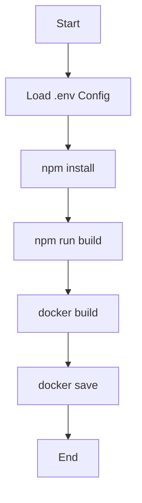

# 设计文档 - 前端远程镜像构建

## 1. 整体架构
本任务不涉及新代码开发，而是执行现有的构建流水线。

### 构建流水线

## 2. 核心组件
- **Script**: `build_remote_image.ps1` - 编排整个构建过程。
- **Builder**: Node.js/Vite - 用于构建前端静态资源。
- **Container**: Docker - 用于打包应用和 Python 服务器。
- **Config**: `.env` - 提供端口和 API URL 配置。

## 3. 数据流向
1. 源码 (`src/`) -> Vite Build -> 静态资源 (`dist/`)
2. 静态资源 (`dist/`) + `Dockerfile` -> Docker Build -> Docker Image
3. Docker Image -> Docker Save -> Tar File (`image/remote/`)

## 4. 异常处理
- 脚本中已包含 `try-catch` 块。
- `npm` 或 `docker` 命令失败将触发异常并终止脚本。
