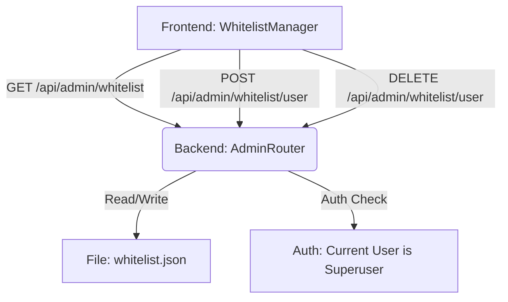

# DESIGN_Whitelist_Management

## 1. 整体架构
本功能涉及前后端修改，核心是增加对 `whitelist.json` 的 CRUD 能力。



## 2. 模块设计

### 2.1 Backend (Daisy_server)

#### 2.1.1 `app/core/config.py`
- **Modify** `load_whitelist()`: 保持现状，确保能读取最新的文件。
- **Add** `save_whitelist(data: dict)`:
  - 接收完整的 whitelist 字典。
  - 写入 `whitelist.json`。
  - 使用 `json.dump` 格式化输出 (indent=4)。
  - 增加异常处理和日志。

#### 2.1.2 `app/api/admin.py` (New File)
- **Router**: `router = APIRouter(prefix="/admin", tags=["admin"])`
- **Models**:
  - `WhitelistUserAdd`: `{ username: str, gender: str = "male" }`
  - `WhitelistResponse`: `{ users: List[Union[str, dict]], admins: List[str] }`
- **Endpoints**:
  - `GET /whitelist`:
    - Dep: `get_current_user` (check `is_superuser`).
    - Logic: Call `load_whitelist()`.
  - `POST /whitelist/user`:
    - Dep: `get_current_user` (check `is_superuser`).
    - Logic: 
      1. Load current whitelist.
      2. Check if user exists.
      3. Append new user object/string.
      4. Call `save_whitelist()`.
  - `DELETE /whitelist/user/{username}`:
    - Dep: `get_current_user` (check `is_superuser`).
    - Logic:
      1. Load current whitelist.
      2. Filter out user by username.
      3. Call `save_whitelist()`.

#### 2.1.3 `app/api/server.py`
- Include `admin.router`.

### 2.2 Frontend (Daisy_front)

#### 2.2.1 `src/components/WhitelistManager.tsx` (New Component)
- **State**:
  - `whitelist`: Array of users.
  - `loading`: boolean.
- **UI**:
  - **Header**: Title "白名单管理".
  - **Add Form**: Inline form with `Username` (Input) and `Gender` (Select). "Add" Button.
  - **Table**: 
    - Columns: Username, Gender, Actions (Delete).
    - DataSource: `whitelist`.
- **Logic**:
  - `fetchWhitelist()`: GET `/api/admin/whitelist`.
  - `handleAdd()`: POST `/api/admin/whitelist/user`.
  - `handleDelete(username)`: DELETE `/api/admin/whitelist/user/{username}`.

#### 2.2.2 `src/App.tsx`
- Import `WhitelistManager`.
- Add new TabItem if `isSuperUser`.

## 3. 接口契约

### 3.1 GET /api/admin/whitelist
**Response**:
```json
{
  "users": [
    "user1",
    { "username": "user2", "gender": "female" }
  ],
  "admins": ["admin"]
}
```

### 3.2 POST /api/admin/whitelist/user
**Request**:
```json
{
  "username": "newuser",
  "gender": "male"
}
```
**Response**: `200 OK`

### 3.3 DELETE /api/admin/whitelist/user/{username}
**Response**: `200 OK`

## 4. 数据流向
1. Admin 打开 WhitelistManager -> Fetch API -> Load JSON -> Return JSON -> Render Table.
2. Admin 添加用户 -> Post API -> Load JSON -> Append List -> Write JSON -> Return OK -> Frontend Refresh.

## 5. 异常处理
- **文件读写错误**: Log error, return 500.
- **用户已存在**: Return 400 "User already exists".
- **权限不足**: Return 403.
