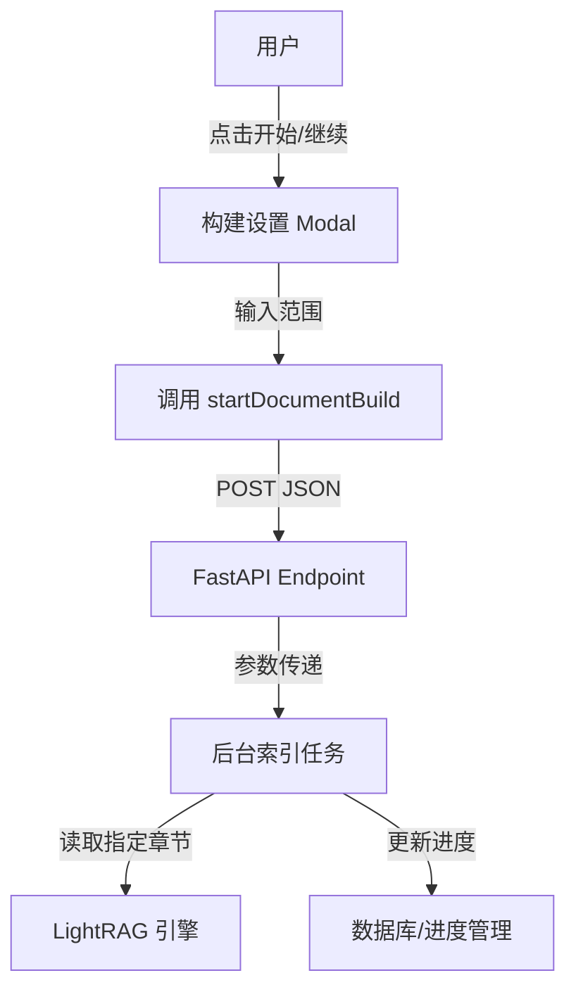

# DESIGN_chapter_range_selection

## 1. 整体架构
本任务涉及前端 UI 交互增强和后端 API 逻辑扩展。不涉及新的微服务或重大架构变更。



## 2. 接口设计

### 2.1 API Endpoint
`POST /novels/{id}/documents/{doc_id}/build/start`

**Request Body (JSON):**
```json
{
  "start_chapter": 1,
  "end_chapter": 50
}
```
*注: 均为可选参数。如果不传，后端自行计算默认值 (从 processed + 1 到 total)。*

### 2.2 前端 API 方法
`novelApi.startDocumentBuild(novelId, docId, startChapter, endChapter)`

## 3. 详细设计

### 3.1 前端 `Library.jsx`
- **State**:
    - `isBuildModalOpen`: boolean
    - `targetDoc`: object (当前操作的文档对象)
    - `buildRange`: `{ start: number, end: number }`
- **UI**:
    - 使用 `Modal` 组件包裹 `Form` 或直接使用两个 `InputNumber`。
    - 验证逻辑: `start > 0`, `end <= total`, `start <= end`.

### 3.2 后端 `novels.py`
- **Model**:
  ```python
  class StartBuildRequest(BaseModel):
      start_chapter: Optional[int] = None
      end_chapter: Optional[int] = None
  ```
- **Task**:
  `async def run_indexing_task(novel_name: str, doc_id: int, start_chapter: Optional[int] = None, end_chapter: Optional[int] = None):`
  
  **Logic**:
  ```python
  # Load chapters
  chapters = ...
  total = len(chapters)
  
  # Determine range
  start_idx = (start_chapter - 1) if start_chapter else doc["processed_chapters"]
  end_idx = end_chapter if end_chapter else total
  
  # Bounds check
  start_idx = max(0, start_idx)
  end_idx = min(total, end_idx)
  
  for i in range(start_idx, end_idx):
      # ... indexing ...
  ```

## 4. 异常处理
- 输入非法范围 (如 start > end): 前端拦截 + 后端校验 (返回 400)。
- 文件不存在/读取失败: 现有逻辑已涵盖。
