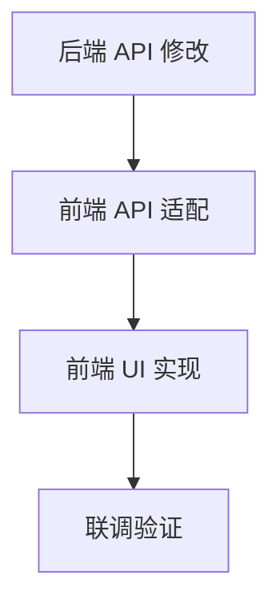

# TASK_chapter_range_selection

## 任务依赖图

## 任务列表

### Task 1: 后端 API 修改
- **描述**: 修改 `src/api/novels.py`，更新 `start_document_build` 接口和 `run_indexing_task` 逻辑。
- **输入**: `DESIGN_chapter_range_selection.md`
- **输出**: 更新后的 `src/api/novels.py`
- **验收标准**:
    - 接口接收 `start_chapter` 和 `end_chapter` 参数。
    - 后台任务仅处理指定范围的章节。
    - 单元测试/手动测试通过。

### Task 2: 前端 API 适配
- **描述**: 修改 `web/src/api/novel.js`，更新 `startDocumentBuild` 方法。
- **输入**: Task 1 完成
- **输出**: 更新后的 `web/src/api/novel.js`
- **验收标准**: 调用时正确传递 JSON body。

### Task 3: 前端 UI 实现
- **描述**: 修改 `web/src/pages/Library.jsx`，添加 Modal 和相关交互逻辑。
- **输入**: Task 2 完成
- **输出**: 更新后的 `web/src/pages/Library.jsx`
- **验收标准**:
    - 点击开始/继续弹出 Modal。
    - 输入范围有效性校验。
    - 确认后正确调用 API。

### Task 4: 联调验证
- **描述**: 运行应用，实际执行一个范围构建任务，观察进度和日志。
- **输入**: Task 3 完成
- **输出**: `ACCEPTANCE_chapter_range_selection.md`
- **验收标准**: 功能按预期工作，无报错。
