# 项目需求深度分析与对齐 (Deep Alignment)

## 1. 核心目标深化
构建一个 **"小说 -> 智能体" 的转化工厂 (`Daisy_brain`)**。
不仅仅是简单的文本分块检索，而是要构建一个**有灵魂、有记忆、有行为逻辑**的角色智能体。

## 2. 需求覆盖率逐条审视 (Coverage Review)

### 2.1 角色基础与人格
| 需求点 | 覆盖情况 | 实现策略深化 |
| :--- | :--- | :--- |
| **角色基本设定** | ✅ 已覆盖 | 利用 LightRAG 聚合该角色所有 Entity 描述，由 LLM 总结生成标准 JSON 字段 (姓名, 年龄, 外貌)。 |
| **潜在人格/口癖** | ⚠️ **需增强** | **新增**: 专门的 "Dialogue Extractor"。检索该角色的 Top-50 对话片段，分析其句式结构、常用词 (如"罢了"、"偏偏")、语气助词。生成 Few-shot 对话示例库。 |
| **心理活动** | ⚠️ **需增强** | **新增**: "Inner Monologue Extractor"。专门检索包含 "想道"、"思忖"、"暗道" 等关键词的段落，提取角色未说出口的真实想法，作为 "思维链" 素材。 |

### 2.2 关系与阵营
| 需求点 | 覆盖情况 | 实现策略深化 |
| :--- | :--- | :--- |
| **人物关系** | ✅ **核心强项** | LightRAG 天然生成 Entity-Relation 图。将明确要求抽取 `Relation Type` (如: 亲属, 敌对, 盟友)。 |
| **人物阵营/立场** | ✅ 已覆盖 | 基于图谱的社区发现 (Community Detection)。自动识别角色所属的小团体 (Clique)，并分析该团体的共同目标作为 "立场"。 |

### 2.3 事件与剧情 (关键深化点)
| 需求点 | 覆盖情况 | 实现策略深化 |
| :--- | :--- | :--- |
| **发生过的事件** | ⚠️ **需结构化** | **新增**: **事件知识图谱 (EventKG)**。不仅仅抽取人物，还要抽取 "事件" 作为节点。 |
| **事件中的细节** | ✅ 已覆盖 | 事件节点将包含属性：`Participants` (参与者), `Dialogue` (关键对话), `Action` (关键行为), `Mood` (氛围)。 |
| **剧情触发点** | ⚠️ **需增强** | **新增**: "Trigger Pattern Recognition"。基于 EventKG，分析 "Condition -> Action" 模式。例如检索 "林黛玉" + "哭泣" 的所有事件，分析前置条件通常是什么 (看到落花? 听到无情话?)。 |

## 3. 核心架构升级：引入事件知识图谱 (Event Knowledge Graph)

针对您提到的 **"是不是要构建事件的知识图谱"**，答案是 **必须构建**。
传统的 LightRAG 更多关注 `实体(Entity)` 和 `关系(Relation)`。我们需要扩展它以支持 `事件(Event)`。

### 3.1 图谱结构定义
在 LightRAG 的基础上，增加 `Event` 类型的节点：
-   **Nodes**:
    -   `Character`: 林黛玉, 贾宝玉
    -   `Event`: 黛玉葬花, 宝玉挨打, 共读西厢
    -   `Location`: 潇湘馆, 怡红院
-   **Edges**:
    -   `PARTICIPATED_IN`: 林黛玉 -> 参与 -> 黛玉葬花
    -   `CAUSED`: 宝玉调戏金钏 -> 导致 -> 宝玉挨打
    -   `HAPPENED_AT`: 黛玉葬花 -> 发生于 -> 沁芳闸
    -   `NEXT`: 黛玉葬花 -> 之后是 -> 宝玉探病 (时序关系)

### 3.2 触发点抽取逻辑 (The "If-Then" Logic)
基于 EventKG，我们可以执行高级推理：
1.  **Query**: "Find all events where `Action` is 'Cry' and `Subject` is 'Lin Daiyu'."
2.  **Analyze**: 查看这些 Event 节点的前置节点 (Preceding Events) 或 原因边 (Caused By)。
3.  **Synthesize**: 总结出规则 —— "If (用户提及落花 OR 用户态度冷淡) Then (执行动作: 哭泣/自怜)"。

## 4. 状态流转图 (State Machine)
*(保持不变，但内部逻辑已根据上述审视进行了增强)*

```mermaid
stateDiagram-v2
    [*] --> Uploaded: 小说文件上传
    Uploaded --> Preprocessing: 启动处理
    
    state Preprocessing {
        [*] --> Cleaning: 文本清洗/分章
        Cleaning --> Chunking: 文本分块
        Chunking --> [*]
    }
    
    Preprocessing --> Indexing: 预处理完成
    
    state Indexing {
        [*] --> ExtractingEntities: 抽取实体 (人/物/地)
        ExtractingEntities --> ExtractingEvents: **抽取事件节点 (Event Extraction)**
        ExtractingEvents --> ExtractingRelations: 构建关系 (人-人, 人-事, 事-事)
        ExtractingRelations --> BuildingGraph: 构建包含 Event 的异构图
        BuildingGraph --> GeneratingEmbeddings: 生成向量索引
        GeneratingEmbeddings --> [*]
    }
    
    Indexing --> Ready: 知识库就绪
    
    state Ready {
        [*] --> CharacterDiscovery: 自动识别主要角色
        CharacterDiscovery --> UserSelection: 等待用户选择角色
    }
    
    UserSelection --> ExtractingProfile: 用户选定角色
    
    state ExtractingProfile {
        [*] --> BaseInfo: 抽取基本信息
        BaseInfo --> Personality: 抽取人格 & **口头禅(Few-Shot)**
        Personality --> Relationships: 分析阵营 & 立场
        Relationships --> Events: **检索参与的关键事件 (心理/行为)**
        Events --> Triggers: **推导剧情触发点 (If-Then)**
        Triggers --> [*]
    }
    
    ExtractingProfile --> Reviewing: 生成初稿
    
    state Reviewing {
        [*] --> HumanEditing: 用户编辑/修正
        HumanEditing --> ValidationChat: 模拟对话验证
        ValidationChat --> HumanEditing: 反馈调整
        ValidationChat --> Finalizing: 验证通过
    }
    
    Finalizing --> Exported: 导出角色包
    Exported --> [*]
```

## 5. 待确认的决策点 (Decision Points)

### Q1: 事件抽取的粒度
-   **细粒度**: 每一场对话都算一个事件 (节点数爆炸，关系精准)。
-   **粗粒度 (推荐)**: 以 "章" 或 "场景" 为单位 (如 "第23回-西厢记妙词通戏语")。
    -   *决策*: 建议采用 **场景级 (Scene-level)** 事件抽取。

### Q2: 触发器 (Trigger) 的表现形式
-   最终生成的 JSON 中，触发器是：
    -   A) **自然语言描述**: 给 LLM 看的 System Prompt (e.g. "Note: When user mentions X, you must Y").
    -   B) **结构化代码**: 给程序看的 (e.g. Python 函数或规则配置)。
    -   *决策*: 建议 **A (自然语言)** 为主，配合少量 **B (关键状态变更)**。因为 LLM 对自然语言指令的遵循能力已经很强，硬编码规则太死板。

## 6. 下一步计划 (Next Steps)
1.  **更新架构设计**: 明确 `EventGraphBuilder` 模块。
2.  **设计数据结构**: 定义 `EventNode` 和 `TriggerRule`。
3.  **开始任务拆解**。

请确认以上审视是否满足您对“覆盖率”的要求？
