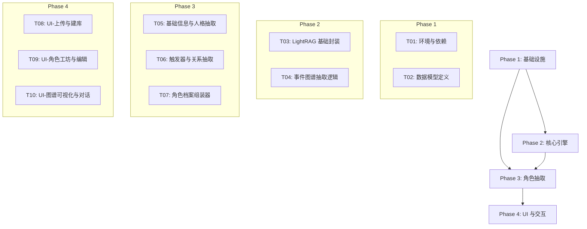

# 任务分解 (Atomize)

## 任务依赖图

## 详细子任务列表

### Phase 1: 基础设施 (Infrastructure)
-   **[TASK-01] 环境与项目结构初始化**:
    -   创建 `Daisy_brain` 目录结构。
    -   完善 `requirements.txt` (lightrag-hku, streamlit, pydantic, networkx, pyvis, tiktoken)。
    -   创建 `src/core/config.py` 处理环境变量和路径。
    -   **验收**: 目录结构建立，依赖安装成功。

-   **[TASK-02] 数据模型定义 (Domain Models)**:
    -   在 `src/core/models.py` 中定义 `ExtendedRoleProfile`, `PlotTrigger`, `Relationship`。
    -   定义 `EventNode` 结构。
    -   **验收**: Pydantic 模型代码完成，单元测试验证序列化/反序列化。

### Phase 2: 核心引擎 (Core Engine)
-   **[TASK-03] LightRAG 服务封装**:
    -   创建 `src/core/rag_engine.py`。
    -   实现 `initialize_index(text_path)`。
    -   实现基础 `query(text)`。
    -   **验收**: 能读取 txt 文件并生成 LightRAG 本地索引文件。

-   **[TASK-04] 事件图谱增强 (Event Graph)**:
    -   定制 LightRAG 的 Entity Extraction Prompt (在 `src/extractors/prompts.py`)，增加 "Event" 类型定义。
    -   实现 `extract_events_from_graph()` 方法，从生成的 Graph 中过滤出事件节点。
    -   **验收**: 索引后能查询到类型为 "Event" 的节点，且包含时序关系。

### Phase 3: 角色抽取 Agent (Extractor)
-   **[TASK-05] 基础信息与人格抽取**:
    -   实现 `src/extractors/character.py` 中的 `extract_basic_info` 和 `extract_personality`。
    -   使用 Global Query 总结人物画像。
    -   使用 Local Query 抽取 5-10 条代表性 Dialogue。
    -   **验收**: 输入 "林黛玉"，输出包含姓名、性格描述、口头禅的 JSON 片段。

-   **[TASK-06] 触发器与关系抽取**:
    -   实现 `extract_relationships` (基于图谱边)。
    -   实现 `extract_triggers` (基于事件节点的因果分析)。
    -   **验收**: 输出包含 Relationships 列表和 Triggers 列表。

-   **[TASK-07] 角色档案组装器**:
    -   整合 T05 和 T06 的结果，生成完整的 `ExtendedRoleProfile` 对象。
    -   实现保存为 JSON 文件的功能。
    -   **验收**: 完整流程跑通，生成符合定义的 JSON 文件。

### Phase 4: UI 与交互 (Streamlit UI)
-   **[TASK-08] UI - 上传与建库**:
    -   创建 `ui/pages/1_Import.py`。
    -   实现文件上传组件，调用 T03 的索引功能，显示进度。
    -   **验收**: 能够上传 txt 并触发后台索引构建。

-   **[TASK-09] UI - 角色工坊**:
    -   创建 `ui/pages/2_Extract.py`。
    -   输入角色名 -> 调用 T07 -> 显示 JSON 编辑器。
    -   **验收**: 能够抽取并手动修改、保存角色档案。

-   **[TASK-10] UI - 可视化与对话**:
    -   创建 `ui/pages/3_Chat.py`。
    -   集成 `streamlit-agraph` 展示人物/事件关系图。
    -   实现简单的 Chat Interface，加载生成的 Profile 作为 System Prompt。
    -   **验收**: 能看到图谱，能与生成的角色对话。
