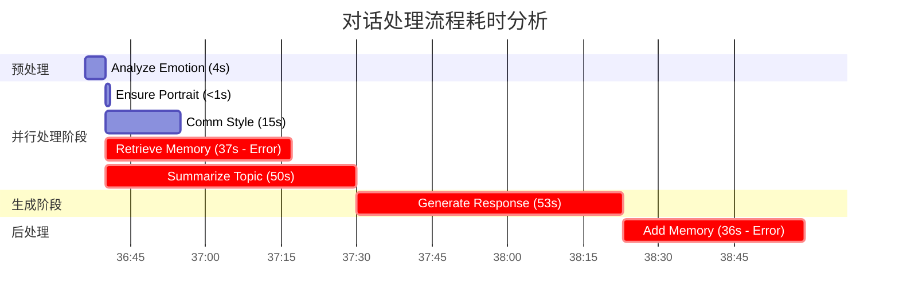

# 后端服务对话性能分析报告

## 1. 概览
本次分析基于最近一次对话请求（Message ID: 39）的 Docker 日志。
- **请求时间**: 2025-12-26 16:36:36
- **结束时间**: 2025-12-26 16:38:59
- **总耗时**: **143 秒 (约 2 分 23 秒)**
- **结论**: 响应时间严重超出正常范围，主要受限于**网络连接不稳定**和**LLM推理速度/重试机制**。

## 2. 详细阶段耗时分析

以下是对话处理流程的甘特图，展示了各阶段的并行关系及耗时：



### 阶段耗时明细表

| 阶段 (Node) | 开始时间 | 结束时间 | 耗时 | 状态 | 备注 |
| :--- | :--- | :--- | :--- | :--- | :--- |
| **analyze_emotion** | 16:36:36 | 16:36:40 | 4s | 正常 | 情感分析 |
| **ensure_portrait** | 16:36:40 | 16:36:40 | <1s | 正常 | 获取角色画像 |
| **analyze_communication_style** | 16:36:40 | 16:36:55 | 15s | 警告 | 发生 `/embeddings` 重试 |
| **retrieve_memory** | 16:36:40 | 16:37:17 | **37s** | **失败** | Connection error, 导致长时间超时等待 |
| **summarize_topic** | 16:36:40 | 16:37:30 | **50s** | 正常 | 话题总结，LLM 调用耗时较长 |
| **generate_response** | 16:37:30 | 16:38:23 | **53s** | 正常 | 核心回复生成 (CrewAI StyleAgent) |
| **Post-processing** | 16:38:23 | 16:38:59 | **36s** | **失败** | 添加记忆失败 (Connection error) |

## 3. 核心瓶颈识别

### 1. 网络连接不稳定 (Critical)
- **现象**: `retrieve_memory` 和 `Post-processing` 阶段均出现 `Connection error`。
- **影响**: 导致系统在该阶段长时间挂起（等待超时），分别浪费了 37s 和 36s。
- **证据**:
  ```log
  [2025-12-26 16:37:17] [ERROR] 搜索记忆失败: Connection error.
  Retrying request to /embeddings in 0.901316 seconds
  ```

### 2. LLM 推理与 Agent 执行缓慢 (High)
- **现象**: `generate_response` 耗时 53s，`summarize_topic` 耗时 50s。
- **原因**: 
    - 使用了 `CrewAI` 框架，可能包含多次 LLM 交互（Thought/Action/Observation 循环）。
    - 模型响应速度慢（DeepSeek-V3.2 via OpenAI provider）。
    - 串行执行：`generate_response` 必须等待所有并行任务（包括最慢的 `summarize_topic`）完成后才能开始。

### 3. 并行任务的短板效应
- **现象**: 虽然 `analyze_communication_style` (15s) 和 `ensure_portrait` (<1s) 很快完成，但主流程被 `summarize_topic` (50s) 卡住。
- **影响**: 并行优势未完全发挥，整体受限于最慢的节点。

## 4. 优化建议

### 针对网络问题
1.  **检查向量数据库/Redis 连接**: 确认 `daisy_qdrant_local` 和 `daisy_redis_local` 容器的健康状态及网络连通性。日志中的 Connection error 很可能指向这些服务或外部 LLM API 的网络抖动。
2.  **优化超时与重试策略**: 当前的重试机制似乎导致了过长的等待时间。建议缩短连接超时时间（Connect Timeout），避免在网络不可用时长时间阻塞。

### 针对性能问题
1.  **流式输出 (Streaming)**: 目前 `generate_response` 需要等待 53s 才能生成完整回复。如果前端支持，应启用 LLM 流式输出，让用户立刻看到首字。
2.  **异步后处理**: 将 `Add Memory` (记忆存储) 和 `Summarize Topic` (如果非阻塞) 移至后台异步执行，回复生成后立即返回给用户，无需等待这些任务完成。
3.  **缓存优化**: `summarize_topic` 耗时 50s，如果话题未发生重大变化，可考虑缓存话题摘要。
4.  **模型蒸馏/量化**: 考虑使用更轻量级的模型处理 `summarize_topic` 等非核心任务，保留大模型处理 `generate_response`。

## 5. 结论
当前系统的主要瓶颈在于**不稳定的网络连接导致的超时重试**以及**大模型推理的固有延迟**。修复网络连接问题预计可将总耗时减少约 30-40% (消除错误等待时间)，而采用异步处理和流式输出可大幅提升用户的主观响应速度。
