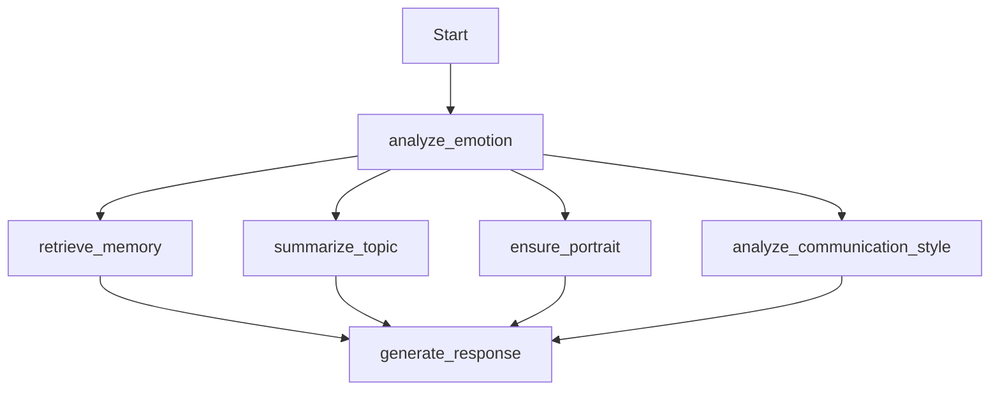
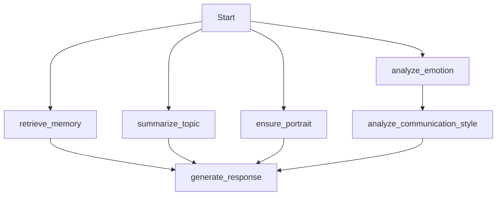

# 工作流执行全流程分析报告

## 1. 当前工作流执行时序 (基于日志)

根据 `latest_workflow.log` (测试时间: 07:42 - 07:44)，一次完整的对话处理流程耗时约 **2分24秒**。

### 关键路径节点耗时拆解

1.  **[串行头部] 情感分析 (`analyze_emotion`)**
    *   **耗时**: ~20秒 (07:42:09 - 07:42:29)
    *   **主要动作**: 调用 `EmotionTranslator` (LLM) 进行文本翻译。
    *   **状态**: 阻塞后续所有并行节点。

2.  **[并行阶段] 四路并发** (07:42:29 开始)
    *   **分支 A: 确保画像 (`ensure_portrait`)**
        *   **耗时**: <1秒 (使用缓存)。
    *   **分支 B: 记忆检索 (`retrieve_memory`)**
        *   **耗时**: ~3秒 (07:42:29 - 07:42:32)。
        *   **动作**: Qdrant 向量检索。
    *   **分支 C: 沟通风格分析 (`analyze_communication_style`)**
        *   **耗时**: ~11秒 (07:42:29 - 07:42:40)。
        *   **动作**: 调用远程 LLM (StrategyAgent)。
    *   **分支 D: 话题总结 (`summarize_topic`)**  🔴 **[严重瓶颈]**
        *   **耗时**: **~79秒** (07:42:29 - 07:43:48)。
        *   **动作**: 调用 **本地 LLM (CPU)** 进行总结。
        *   **影响**: 导致后续生成节点必须等待至 07:43:48 才能启动。

3.  **[串行尾部] 回复生成 (`generate_response`)**
    *   **耗时**: ~43秒 (07:43:48 - 07:44:31)。
    *   **动作**:
        *   StyleAgent (LLM): ~14秒
        *   FinalResponseAgent (LLM): ~25秒

## 2. 依赖关系分析 (Graph Structure)

### 当前结构

### 依赖有效性审查
*   **`analyze_communication_style`**: 确实依赖 `analyze_emotion` 的输出 (Emotions)，必须在情感分析之后。
*   **`retrieve_memory`**: **无依赖**。仅需 `user_input`，无需等待情感分析。
*   **`summarize_topic`**: **无依赖**。仅需 `user_input` 和历史记录，无需等待情感分析。
*   **`ensure_portrait`**: **无依赖**。仅需 `user_id`，无需等待情感分析。

## 3. 优化建议

### 优化点 1: 调整图结构 (Graph Restructuring)
将不依赖情感分析的节点提前到入口处并行执行，可节省约 **20秒** (情感分析的耗时) 的等待时间。

**建议结构**:

### 优化点 2: 解决话题总结瓶颈
`summarize_topic` 使用本地 LLM (CPU) 耗时过长 (79秒)，严重拖慢整体响应。

**方案 A (配置优化)**:
*   在 Docker 环境下（无 GPU），建议禁用 Topic Summary 的本地 LLM，改用远程 LLM (通常 <15秒)。
*   修改配置: `LOCAL_LLM_ENABLED=False` (或者在代码逻辑中针对 Topic Summary 强制使用远程)。

**方案 B (流程优化 - 异步非阻塞)**:
*   **核心问题**: `generate_response` 是否真的需要**当前轮次**的实时总结？
*   **策略**: 如果生成回复主要依赖 `retrieve_memory` (相关记忆) 和 `chat_history` (最近 N 条原始对话)，那么 `summarize_topic` (用于长上下文压缩) 可以**移出主阻塞路径**。
*   **实现**: 将 `summarize_topic` 设为后台任务，或者在 `generate_response` 中不强依赖其最新输出（使用上一轮的总结 + 原始历史）。

### 优化点 3: 情感分析翻译优化
*   当前 `analyze_emotion` 总是先调用 LLM 翻译。
*   **策略**: 增加简单的语言检测。如果是英文或简短中文（BERT 模型直接支持），跳过翻译步骤。

## 4. 预期收益
如果实施 **优化点 1** 和 **优化点 2 (切换远程 LLM)**:
*   **并行收益**: 节省 ~20秒 (Memory/Topic 提前运行)。
*   **消除瓶颈**: 节省 ~60秒 (Topic Summary 从 79s -> ~15s)。
*   **总耗时预估**: 从 **144秒** 降低至 **~60-70秒** (提升 50%+)。
