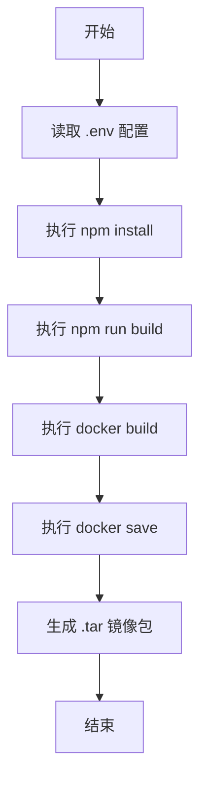

# DESIGN_rebuild_frontend

## 1. 执行流程设计

## 2. 关键组件
- **PowerShell 脚本**: 自动化构建流程的核心控制器。
- **Node.js/npm**: 前端构建工具。
- **Docker**: 容器化和镜像打包工具。

## 3. 验证策略
- 检查脚本退出代码 (Exit Code)。
- 检查 `image/remote` 目录下是否生成了新的文件。
